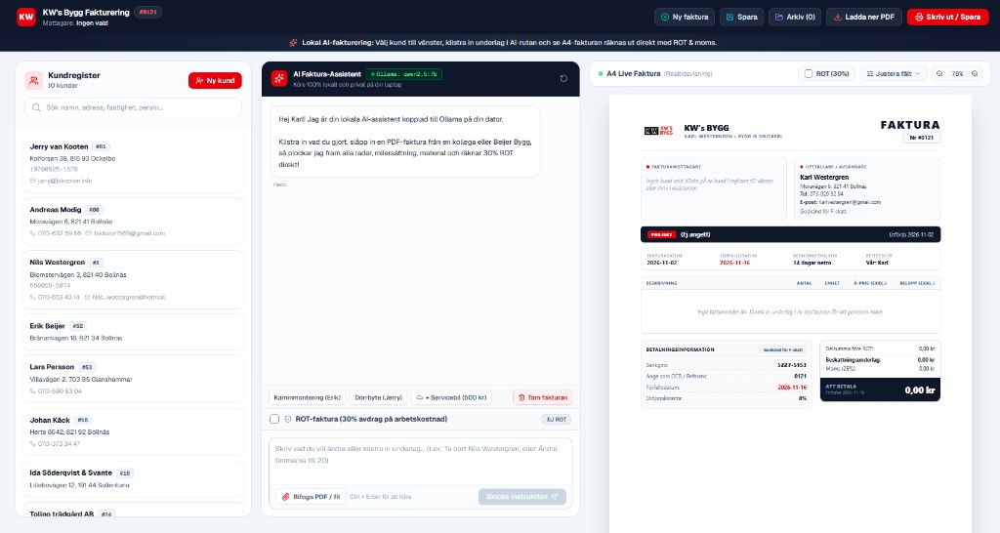

# KW's Bygg Fakturering (`invoicer-app`)

Ett modernt, intelligent och lokalt faktureringssystem framtaget för **KW's Bygg (Karl Westergren)** och svenska hantverkare. Applikationen ersätter gamla, stela PDF-blanketter (som Visma SPCS) med ett blixtsnabbt webbgränssnitt, realtidsberäkningar, kundregister och en lokal **AI-assistent driven av Ollama**.

---

## 📸 Skärmdump & Översikt



Gränssnittet är uppdelat i en ren och effektiv 3-kolumns layout (samt mobilanpassad flikmeny):
- **Vänster:** Kundregister med blixtsnabb realtidssökning och rena kontaktkort.
- **Mitten:** AI-assistent i Cursor-stil (driven av lokal Ollama) för inmatning av timmar, bifogade underlag och ändringar.
- **Höger:** Interaktiv A4-faktura med realtidsberäkning, ROT-avdrag och skarp PDF-export.

---

## ✨ Huvudfunktioner

### 1. 👥 Kundregister med realtidssökning
* **Live-filtrering:** Filtrerar ögonblickligen bland sparade kunder allteftersom du skriver på namn, gatuadress, ort, telefon, e-post, personnummer eller kundnummer.
* **Rena kundkort:** Visar enbart beställarens kontaktuppgifter utan gamla projektnamn.
* **1-klicksaktivering:** Klicka på valfri kund i listan så fylls alla uppgifter, kundnummer och personnummer i direkt på fakturan.
* **Hantera kunder:** Lägg till nya kunder eller redigera befintliga via ett snabbt popup-formulär.

### 2. 🤖 AI Faktura-Assistent (Cursor-stil med lokal Ollama)
* **Körs 100% lokalt & privat:** Använder **Ollama** med modellen **`qwen2.5:7b`** som körs i hårdvaruacceleration på datorns grafikkort (NVIDIA RTX 3070 Ti, ~4.4 GB VRAM). Ingen känslig kunddata eller personnummer skickas till molnet.
* **Naturligt språk:** Skriv instruktioner som du vill:
  > *"Dörrbyte hos Jerry. 5 timmar snickeri á 550 kr. Nils Westergren hade 5 timmar á 550 kr, 13 mil milersättning och 50 kr material. 30% ROT."*
* **Bifoga PDF-underlag:** Stöd för att ladda upp PDF-fakturor från kollegor eller bygghandeln (t.ex. Beijer Bygg). Texten extraheras automatiskt och analyseras av AI:n.
* **Flersidigt konversationsminne:** Ändra och justera fakturan i dialog med assistenten:
  > *"Ta bort servicebilen och ändra mina timmar till 20"*
  AI:n behåller befintliga rader och utför exakt den ändring du bad om.
* **Automatisk kundigenkänning:** Om du nämner ett kundnamn (t.ex. *"skapa en faktura med Erik Beijer..."*) kopplas rätt kundkort från registret automatiskt.
* **Fallback-läge:** Om Ollama inte är igång faller systemet mjukt tillbaka på en inbyggd svensk regelmotor.

### 3. 📄 Live Modern A4-Faktura
* **Skandinavisk design:** Byggd med modern typografi (*Plus Jakarta Sans*), tydlig informationshierarki och KW's Byggs röda profilfärg.
* **Automatisk matematik:**
  * Beräknar delsummor, moms (25%) och svensk öresutjämning i realtid.
  * **ROT-avdrag (30%):** Beräknar skattereduktionen korrekt på arbetskostnaden *inklusive moms* och specificerar tydligt kundens nettosumma samt beloppet att ansöka från Skatteverket.
  * ROT-regler respekteras strikt: Material, servicebil och milersättning exkluderas alltid från ROT.
* **Interaktiv ROT-brytare:** Slå av och på 30% ROT-avdrag med ett enda klick via bockrutan.
* **Ren startvy:** Appen startar alltid med en ren, tom fakturamall redo för nästa fakturanummer.

### 4. 📱 Mobiloptimerad för användning på språng
* **Responsiv layout:** På mobiltelefoner fälls kolumnerna ihop till en smidig bottenmeny med tre flikar:
  * `[Kunder]` – Välj eller sök kund.
  * `[AI Assistent]` – Skriv prompt, bifoga underlag eller tryck snabbknappar.
  * `[Faktura A4]` – Granska fakturan och ladda ner PDF.
* **Fjärråtkomst:** Servern lyssnar på `0.0.0.0:3000` vilket gör att du kan nå appen direkt från mobilen via lokalt Wi-Fi eller via **Tailscale** när du är ute på byggen.

---

## 🛠️ Teknisk arkitektur

| Komponent | Teknologi | Beskrivning |
| :--- | :--- | :--- |
| **Frontend Framework** | **Next.js 16 (Turbopack)** | React 19, App Router, SSR & Client Components |
| **Språk** | **TypeScript 5** | Strikt typning för alla fakturamodeller och beräkningar |
| **Styling** | **Tailwind CSS 4** | Responsiv layout, utility-first styling, print-stilar |
| **Ikoner** | **Lucide React** | Moderna och enhetliga gränssnittsikoner |
| **Lokal AI Engine** | **Ollama** | Kör `qwen2.5:7b` (Q4_K_M) lokalt via REST API (`/api/generate`) |
| **PDF-extraktion** | **PyMuPDF (fitz)** | Snabb och robust textextraktion ur uppladdade fakturaundelag |
| **PDF-export** | **jsPDF / html2canvas** | Direkt nedladdning av A4-PDF i webbläsaren |
| **Datalagring** | **Web Storage (localStorage)** | Lokal synkning av kundregister, fakturahistorik och inställningar |

---

## 📁 Projektstruktur

```
invoicer-app/
├── src/
│   ├── app/
│   │   ├── api/
│   │   │   ├── ai/
│   │   │   │   ├── extract-pdf/route.ts   # Extraherar text ur uppladdade PDF:er via PyMuPDF
│   │   │   │   ├── parse-invoice/route.ts # Huvud-API för Ollama / AI-fakturaparsing
│   │   │   │   └── status/route.ts        # Kollar om Ollama körs och kontrollerar VRAM
│   │   ├── layout.tsx                     # Global layout med Plus Jakarta Sans
│   │   ├── page.tsx                       # Huvudsida med 3-kolumnsvy och tillståndshantering
│   │   └── globals.css                    # Tailwind CSS och utskriftsanpassningar
│   ├── components/
│   │   ├── AiAssistant.tsx                # Prompt- och chatkomponent med bifoga-stöd
│   │   ├── CustomerSidebar.tsx            # Kundregister med sök och redigering
│   │   ├── Header.tsx                     # Toppmeny med åtgärder och mobilflikar
│   │   ├── InvoicePreview.tsx             # Modern pixel-perfekt A4-förhandsgranskning
│   │   ├── InvoiceEditor.tsx              # Detaljerad formulärredigerare
│   │   └── SavedInvoicesModal.tsx         # Arkiv över sparade fakturor
│   ├── types/
│   │   └── invoice.ts                     # Datastrukturer för fakturor, rader och kunder
│   └── utils/
│       ├── calculations.ts                # Matematiska beräkningar för moms, ROT och avrundning
│       ├── pdfExport.ts                   # Exportfunktioner till PDF och utskrift
│       └── storage.ts                     # Hantering av kundregister och lokal lagring
├── public/
│   └── kws-bygg-logo.png                  # Företagslogotyp
└── README.md
```

---

## 🚀 Kom igång

### Förutsättningar
1. **Node.js** (v18 eller senare)
2. **Python** med `pymupdf` installerat:
   ```bash
   pip install pymupdf
   ```
3. **Ollama** installerat på datorn med modellen `qwen2.5:7b`:
   ```bash
   ollama pull qwen2.5:7b
   ```

### Installation & Start

1. Klona repositoryt:
   ```bash
   git clone https://github.com/Brottarbengt/invoicer-app.git
   cd invoicer-app
   ```

2. Installera npm-beroenden:
   ```bash
   npm install
   ```

3. Bygg produktionsversionen:
   ```bash
   npm run build
   ```

4. Starta servern med nätverksåtkomst:
   ```bash
   npx next start -H 0.0.0.0 -p 3000
   ```

5. Öppna webbläsaren:
   * **Från din dator:** [http://localhost:3000](http://localhost:3000)
   * **Från mobilen (samma nätverk):** `http://<din-dators-ip>:3000`
