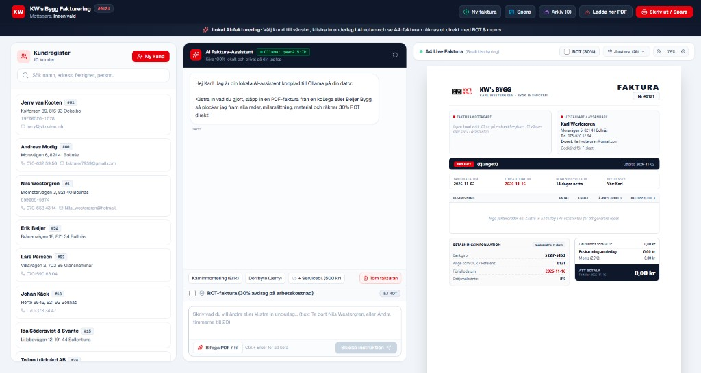

# KW's Bygg Fakturering (`invoicer-app`)

Ett modernt, intelligent och lokalt faktureringssystem framtaget för **KW's Bygg (Karl Westergren)** och svenska hantverkare. Applikationen ersätter gamla, stela PDF-blanketter (som Visma SPCS) med ett blixtsnabbt webbgränssnitt, realtidsberäkningar, permanent SQLite-kundregister och en lokal **AI-assistent driven av Ollama**.

---

## 📸 Skärmdump & Översikt



Gränssnittet är uppdelat i en ren och effektiv 3-kolumns layout (samt mobilanpassad flikmeny):
- **Vänster:** Kundregister med blixtsnabb realtidssökning och rena kontaktkort.
- **Mitten:** AI-assistent i Cursor-stil (driven av lokal Ollama) för inmatning av timmar, bifogade underlag och ändringar.
- **Höger:** Interaktiv A4-faktura med realtidsberäkning, ROT-avdrag och skarp PDF-export.

---

## ✨ Huvudfunktioner

### 1. 👥 Kundregister med realtidssökning
* **Live-filtrering** på namn, adress, ort, telefon, e-post, personnummer eller kundnummer.
* **1-klicksaktivering** fyller kunduppgifter direkt på fakturan.
* **Unika kundnummer** tilldelas via databasen så nummer inte krockar.

### 2. 🤖 AI Faktura-Assistent (lokal Ollama)
* Körs 100% lokalt med **`qwen2.5:7b`** via Ollama.
* Bifoga PDF-underlag (extraheras via PyMuPDF).
* Flersidigt konversationsminne för ändringar utan hallucinerade rader.
* Fallback till inbyggd svensk regelmotor om Ollama är offline.

### 3. 📄 Live A4-faktura & ROT
* Automatisk moms, öresutjämning och **30% ROT** på arbetskostnad.
* **ROT på fil:** exporterar validerad XML (XSD v6.0) för Skatteverkets e-tjänst.
* PDF-nedladdning och utskrift.

### 4. 📱 Mobil & Tailscale
* Mobilflikar: Kunder / AI / Faktura A4.
* Säker fjärråtkomst via Tailscale.

### 5. 🔒 SQLite & Multi-User PIN
* Kunder och fakturor sparas i `data/invoicer.db`.
* PIN-session (30 dagar), BankID-förberedd användarmodell.

---

## 🛠️ Teknisk arkitektur

| Komponent | Teknologi |
| :--- | :--- |
| Frontend | Next.js 16, React 19, TypeScript, Tailwind CSS 4 |
| Databas | SQLite (`node:sqlite`) |
| Auth | PIN + HTTP-only sessions |
| AI | Ollama (`qwen2.5:7b`) |
| PDF | jsPDF / html2canvas + PyMuPDF för underlag |
| Nätverk | Tailscale (valfritt) |

---

## 📁 Projektstruktur

```
invoicer-app/
├── data/
│   └── invoicer.db                        # SQLite (git-ignorerad)
├── src/
│   ├── app/
│   │   ├── api/
│   │   │   ├── ai/                        # extract-pdf, parse-invoice, status
│   │   │   ├── auth/                      # login, logout, me, profile, register
│   │   │   ├── customers/route.ts
│   │   │   ├── invoices/route.ts
│   │   │   └── numbers/next/route.ts      # Nästa faktura-/kundnummer
│   │   ├── layout.tsx
│   │   ├── page.tsx
│   │   └── globals.css
│   ├── components/
│   │   ├── AiAssistant.tsx
│   │   ├── CustomerSidebar.tsx
│   │   ├── Header.tsx
│   │   ├── InvoicePreview.tsx
│   │   ├── PinLoginModal.tsx
│   │   ├── RotExportModal.tsx
│   │   └── SavedInvoicesModal.tsx
│   ├── lib/
│   │   ├── auth.ts
│   │   ├── db.ts
│   │   └── numbering.ts
│   ├── schemas/skatteverket/              # Officiella ROT XSD v6.0
│   ├── types/
│   └── utils/
│       ├── calculations.ts
│       ├── pdfExport.ts
│       ├── rotValidation.ts
│       └── rotXmlExport.ts
├── public/
│   ├── app-screenshot.png
│   └── kws-bygg-logo.png
├── test_rot_xml.py
└── README.md
```

---

## 🚀 Kom igång

### Förutsättningar
1. **Node.js** (v18+, rekommenderat v22+)
2. **Python** med `pymupdf` (+ `xmlschema` för ROT-tester):
   ```bash
   pip install pymupdf xmlschema
   ```
3. **Ollama** med `qwen2.5:7b`:
   ```bash
   ollama pull qwen2.5:7b
   ```
4. **Tailscale** (valfritt).

### Installation & Start

```bash
git clone https://github.com/Brottarbengt/invoicer-app.git
cd invoicer-app
npm install
npm run build
npx next start -H 0.0.0.0 -p 3000
```

### Anslut & Logga in

* **Dator:** [http://localhost:3000](http://localhost:3000)
* **Mobil (Wi-Fi):** `http://<lokal-ip>:3000`
* **Mobil (Tailscale):** `http://<tailscale-ip>:3000`

**Inloggning:** PIN `1234` för Karl Westergren (byt i produktion). Sessionen gäller 30 dagar.
